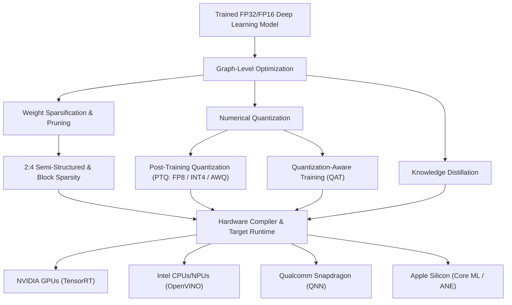

  

# 🚀 Awesome Model Optimization & Sparsification

  
  
  
  
  
  

---

## 📖 Executive Summary & Scope

A comprehensive, production-grade curated catalog of SaaS platforms, cloud compilers, and open-source GitHub projects dedicated to **Deep Learning Model Optimization, Weight Sparsification, Post-Training Quantization (PTQ/QAT), and Hardware-Aware Compilation**. 

As foundation models and deep neural networks grow in parameter count, deploying them efficiently across real-world production hardware—such as datacenter GPUs (NVIDIA/AMD), client CPUs (Intel/AMD), mobile NPUs (Qualcomm Snapdragon/Apple Neural Engine), and embedded edge MCUs—requires aggressive model compression. The tools curated in this repository systematically eliminate parameter redundancy, compress numerical precision from FP32/FP16 down to FP8/INT4/INT2, and synthesize optimized machine code tailored to target silicon execution units.

---

## 📑 Table of Contents

- [🌐 Sector Overview & Market Dynamics](#-sector-overview--market-dynamics)
- [☁️ SaaS & Hosted Optimization Platforms](#️-saas--hosted-optimization-platforms)
- [🛠️ Open-Source GitHub Projects (Ranked by Stars)](#️-open-source-github-projects-ranked-by-stars)
- [🪦 Deprecated & Sunset Projects](#-deprecated--sunset-projects)
- [🏢 Acquired & Absorbed Commercial Platforms](#-acquired--absorbed-commercial-platforms)
- [🔬 Core Optimization Paradigms](#-core-optimization-paradigms)
- [🤝 How to Contribute](#-how-to-contribute)
- [📈 Star History](#-star-history)
- [💖 Support & Community](#-support--community)
- [⚖️ Disclaimer & License](#️-disclaimer--license)

---

## 🌐 Sector Overview & Market Dynamics

The global AI runtime and deep learning model optimization market is valued at **$3.8 Billion in 2025/2026** and is projected to expand to **$12.5 Billion by 2030** at a rapid compound annual growth rate (**CAGR of ~31.2%**), propelled by the explosive cost of LLM serving and surging demand for on-device, low-latency edge AI inference.

Market dynamics reveal that the ecosystem is **highly concentrated and winner-take-all at the silicon and proprietary runtime layer**—dominated by mega-cap chipmakers (Apple, NVIDIA, Amazon AWS, Qualcomm, and Intel) who bundle proprietary compilers and SDKs to safeguard and monetize hardware ecosystems. Conversely, the market remains **moderately fragmented in upstream algorithmic compression**—such as novel weight-only quantization algorithms (AWQ, GPTQ, EXL2), structured pruning tools, and multi-backend compiler graphs (TVM, ONNX Runtime, vLLM).

---

## ☁️ SaaS & Hosted Optimization Platforms

The following hosted cloud platforms and enterprise software suites provide automated model conversion, graph compilation, precision calibration, and hardware profiling. Entries are sorted in descending order by **Company Valuation / Market Capitalization**.

| Platform / Service 🏢 | Company Size (Valuation / Revenue) 💰 | Core Optimization Focus 🎯 | Starting Price Tier 💵 | Free Tier / Trial Limits 🎁 |
| :--- | :--- | :--- | :--- | :--- |
| **[Apple Core ML](https://developer.apple.com/machine-learning/core-ml/)** | **Apple Inc.** • Valuation: ~$3.5 Trillion • Revenue: ~$391 Billion | Automated graph compilation for Apple Silicon; INT4/INT8 linear & palettized weight quantization; dynamic execution dispatch across Apple Neural Engine (ANE), GPU, and CPU. | **$99/year** (Apple Developer Program membership required for App Store & TestFlight distribution; $0 for local offline usage) | **Free Forever** for local offline macOS model conversion via `coremltools` Python SDK, Xcode model compilation, and simulator execution testing. |
| **[NVIDIA AI Enterprise (TensorRT)](https://www.nvidia.com/en-us/data-center/tensorrt/)** | **NVIDIA Corporation** • Valuation: ~$3.4 Trillion • Revenue: ~$130+ Billion | Deep learning inference compiler; layer fusion; kernel auto-tuning; dynamic tensor memory allocation; FP8, FP16, and INT8 post-training calibration for NVIDIA Tensor Cores. | **$1.00 / GPU-hour** (via Cloud Marketplaces) or **$4,500 / GPU / year** enterprise subscription license | **90-Day Free Trial** via NVIDIA LaunchPad and NGC Enterprise evaluation program, including full containerized TensorRT optimization suites. |
| **[AWS SageMaker Neo & AWS Neuron](https://aws.amazon.com/sagemaker/neo/)** | **Amazon.com, Inc. (AWS)** • Valuation: ~$2.0 Trillion • Revenue: ~$105+ Billion (AWS) | Automated graph compilation and operator optimization targeting AWS Inferentia (NeuronCore), AWS Trainium, EC2 GPU instances, and AWS IoT Greengrass edge runtimes. | **$0 / compilation job** (Hosting inference instances start at **$0.05 / hr** for `ml.t3.medium` or **$1.006 / hr** for `ml.g5.xlarge`) | **2 Months Free Tier** under AWS Free Usage: up to 250 hours/month of `ml.t3.medium` instances + unlimited free Neo compilation jobs. |
| **[Qualcomm AI Hub](https://aihub.qualcomm.com/)** | **Qualcomm Inc.** • Valuation: ~$190 Billion • Revenue: ~$39 Billion | Hosted cloud testbed for compiling, quantizing, and profiling PyTorch and ONNX models directly on real physical Snapdragon devices across Hexagon NPU, Adreno GPU, and Kryo CPU. | **$0 / month** (Free cloud developer portal; production commercial runtime licenses embedded in Snapdragon silicon contracts) | **Free Forever** for registered developers: unlimited job submissions, with access to run on real hosted Android/Snapdragon devices (up to 3 concurrent active jobs in queue). |
| **[Intel Tiber Developer Cloud (OpenVINO)](https://cloud.intel.com/)** | **Intel Corporation** • Valuation: ~$95 Billion • Revenue: ~$54 Billion | Cloud-hosted hardware acceleration sandbox for OpenVINO; heterogeneous execution across Intel Xeon Scalable CPUs, Intel Core Ultra NPUs, and Intel Data Center GPU Max/Flex series. | **$0.06 / CPU-hour** (Intel Xeon 4th Gen) or **$1.20 / GPU-hour** (Intel Max 1100 GPU) on pay-as-you-go enterprise compute | **Standard Free Tier** with 50 GB persistent cloud storage, shared JupyterLab environments (up to 16 GB RAM), and 1-hour idle session timeout. |
| **[Edge Impulse (EON Tuner)](https://edgeimpulse.com/)** | **Edge Impulse, Inc.** • Valuation: ~$100 Million (Series B) • Revenue: ~$15 Million (est.) | End-to-end edge ML deployment platform; EON Tuner automated architecture search; INT8 and INT4 microcontroller weight compression targeting ARM Cortex-M, ESP32, and edge MCUs. | **$0 / month** (Developer Plan); Enterprise team licenses custom-quoted starting at **~$10,000 / year** | **Free Forever Developer Plan**: up to 60 minutes compute time per job, 3 private projects, unlimited public projects, and 16 GB compute memory per pipeline run. |
| **[Nota AI NetsPresso](https://netspresso.ai/)** | **Nota AI** • Valuation: ~$80 Million (Series B) • Revenue: ~$8 Million (est.) | Hardware-aware AI compression platform; automated structured filter pruning (SLAMP / L2); mixed-precision quantization; automated hardware-in-the-loop benchmarking on edge devices. | **$0 / month** (Community Tier); Custom Enterprise tiers starting from **$500 / month** for dedicated multi-target compilation pipelines | **Free Forever Community Plan**: includes 5 model compression runs per month, 10 device hardware benchmark profiling tests per month, and PyNetsPresso Python SDK access. |

---

## 🛠️ Open-Source GitHub Projects (Ranked by Stars)

The following open-source frameworks, quantization toolkits, and deep learning compilers provide self-hosted execution, automated weight reduction, and kernel-level hardware acceleration. Repositories are sorted in **descending order by GitHub stargazers**.

1. ### **[llama.cpp](https://github.com/ggerganov/llama.cpp)** 
   - **Focus**: C/C++ LLM inference engine with zero dependencies and bleeding-edge integer quantization.
   - **Key Features**: Pioneers the GGUF container standard, providing 1.5-bit to 8-bit quantization schemes (Q4_K_M, Q5_K_S, IQ2_XXS, IQ4_NL), AVX-512 vector acceleration, Apple Metal GPU offloading, and CPU/GPU split compute.
   - **License**: MIT

2. ### **[vLLM](https://github.com/vllm-project/vllm)** 
   - **Focus**: High-throughput, low-latency LLM serving engine.
   - **Key Features**: Introduces PagedAttention for zero-waste KV cache management, continuous batching, native FP8 / AWQ / GPTQ INT4 execution, Marlin kernel support, and distributed multi-GPU tensor parallelism.
   - **License**: Apache-2.0

3. ### **[ONNX Runtime](https://github.com/microsoft/onnxruntime)** 
   - **Focus**: Microsoft's universal cross-platform model inference and optimization engine.
   - **Key Features**: Pluggable Execution Provider (EP) architecture supporting NVIDIA CUDA, TensorRT, Intel OpenVINO, DirectML, Apple CoreML, and Qualcomm QNN; includes transformer graph simplifiers and post-training dynamic/static quantization.
   - **License**: MIT

4. ### **[TensorRT-LLM](https://github.com/NVIDIA/TensorRT-LLM)** 
   - **Focus**: NVIDIA's production toolkit for compiling and serving optimized LLMs on Tensor Core GPUs.
   - **Key Features**: In-flight batching, fused multi-head attention (FMHA), FP8 quantization, INT4 AWQ execution, KV-cache quantization, and native integration with NVIDIA Triton Inference Server.
   - **License**: Apache-2.0

5. ### **[Apache TVM](https://github.com/apache/tvm)** 
   - **Focus**: End-to-end deep learning compiler stack for CPUs, GPUs, NPUs, and custom ASIC hardware.
   - **Key Features**: TensorIR intermediate representation, machine learning-driven auto-tuning (AutoTVM & MetaSchedule), graph-level operator fusion, and target code generation for LLVM, CUDA, OpenCL, and WebAssembly.
   - **License**: Apache-2.0

6. ### **[OpenVINO Toolkit](https://github.com/openvinotoolkit/openvino)** 
   - **Focus**: Intel's open-source performance inference toolkit for Intel silicon.
   - **Key Features**: Neural Network Compression Framework (NNCF) for automated 8-bit post-training quantization and filter pruning; heterogeneous dispatch across Intel Xeon CPUs, Iris/Arc GPUs, and Intel AI Boost NPUs.
   - **License**: Apache-2.0

7. ### **[bitsandbytes](https://github.com/bitsandbytes-foundation/bitsandbytes)** 
   - **Focus**: Universal 8-bit and 4-bit quantization primitives for PyTorch.
   - **Key Features**: NormalFloat4 (NF4) and FP4 quantization formats, LLM.int8() vector-wise outlier handling, and 8-bit Adam/Paged optimizers for memory-constrained QLoRA fine-tuning and inference.
   - **License**: MIT

8. ### **[AutoGPTQ](https://github.com/AutoGPTQ/AutoGPTQ)** 
   - **Focus**: Easy-to-use LLM 2/3/4/8-bit post-training quantization based on the GPTQ second-order algorithm.
   - **Key Features**: High-speed CUDA, Triton, and Marlin inference kernels; Hugging Face Transformers integration; minimizes perplexity degradation at low bitwidths.
   - **License**: MIT

9. ### **[ExLlamaV2](https://github.com/turboderp/exllamav2)** 
   - **Focus**: Extremely fast local GPU inference engine introducing the EXL2 variable bit-rate quantization format.
   - **Key Features**: Layer-by-layer fractional bit precision (e.g., 2.2 to 6.0 bits/weight), custom CUDA kernels, speculative decoding, and low-overhead 4-bit/8-bit Q/K cache modes.
   - **License**: MIT

10. ### **[AWQ (LLM-AWQ)](https://github.com/mit-han-lab/llm-awq)** 
    - **Focus**: Activation-aware Weight Quantization for LLM compression.
    - **Key Features**: Identifies the top 1% salient weight channels based on activation magnitudes and protects them with per-channel scaling; achieves true INT4 weight-only acceleration without retraining.
    - **License**: Apache-2.0

11. ### **[PyTorch AO (torch.ao)](https://github.com/pytorch/ao)** 
    - **Focus**: PyTorch native architecture optimization for quantization and weight sparsity.
    - **Key Features**: Native PyTorch 2.x composable quantization primitives (int4 weight-only, int8 dynamic/static, FP8 for H100+ GPUs), torch.compile integration, and 2:4 structured sparsity pruning routines.
    - **License**: BSD-3-Clause

12. ### **[Intel Neural Compressor](https://github.com/intel/neural-compressor)** 
    - **Focus**: Multi-framework model compression engine for enterprise workloads.
    - **Key Features**: Automated accuracy-driven quantization tuning, structured channel pruning, weight distillation, and mixed-precision optimization across PyTorch, TensorFlow, and ONNX Runtime.
    - **License**: Apache-2.0

13. ### **[JAX-QNN](https://github.com/carrycooldude/JAX-QNN)** 
    - **Focus**: Qualcomm QNN hardware acceleration backend for JAX.
    - **Key Features**: Direct compilation of JAX StableHLO IR into native Qualcomm execution graphs; delivers **5.6x speedup on Hexagon NPU vs host CPU** on Snapdragon X Elite chips.
    - **License**: Apache-2.0

---

## 🪦 Deprecated & Sunset Projects

> [!WARNING]
> **Neural Magic Ecosystem Deprecation**: Following Red Hat's acquisition of Neural Magic in late 2024, the Neural Magic standalone software stack was **officially deprecated on June 2, 2025**. Engineering resources transitioned upstream to the **vLLM** project. Do not initiate new production deployments on these deprecated libraries:

* **[DeepSparse](https://github.com/neuralmagic/deepsparse)**  — CPU sparsity inference engine utilizing VNNI/AVX-512 instructions (Sunset: June 2025; migrate to Intel OpenVINO or ONNX Runtime).
* **[SparseML](https://github.com/neuralmagic/sparseml)**  — Pruning and sparsification recipe framework for PyTorch models (Sunset: June 2025; migrate to PyTorch AO or Intel Neural Compressor).
* **SparseZoo** — Public repository of pre-sparsified neural networks (Sunset: June 2025).
* **Sparsify** — UI dashboard for hyperparameter pruning schedules (Sunset: June 2025).

---

## 🏢 Acquired & Absorbed Commercial Platforms

Several prominent independent model compression and compilation startups have been acquired by semiconductor giants and incorporated into proprietary enterprise toolchains:

* **Deci AI** — Acquired by **NVIDIA in May 2024**; Automated Neural Architecture Search (AutoNAC) and Infery compiler technology merged into NVIDIA NeMo and TensorRT-LLM.
* **OctoAI (OctoML)** — Acquired by **NVIDIA in September 2024** ($165M–$250M valuation); Apache TVM cloud compilation engine absorbed into NVIDIA cloud acceleration services.
* **Deeplite** — Acquired by **STMicroelectronics in April 2025**; Neutrino neural optimizer embedded directly into ST Edge AI software suite for STM32 microcontrollers.

---

## 🔬 Core Optimization Paradigms

### 1. ✂️ Model Pruning & Sparsification
* **Unstructured Sparsity**: Random zeroing of non-critical weights below a magnitude threshold. High compression ratios, but requires specialized sparse matrix kernels to yield real latency gains.
* **Structured & Semi-Structured Sparsity (2:4)**: Enforces hardware-aligned zero patterns (e.g., 2 out of every 4 consecutive values must be zero). Directly accelerated by NVIDIA Ampere/Hopper/Blackwell Sparse Tensor Cores for immediate 2x matrix math speedups.

### 2. 🎛️ Quantization (FP8, INT8, INT4, NF4)
* **Post-Training Quantization (PTQ)**: Compresses weights and activations with minimal calibration data (no full retraining needed) using methods like AWQ, SmoothQuant, and GPTQ.
* **Quantization-Aware Training (QAT)**: Simulates low-precision rounding errors during training, recovering maximal accuracy for sensitive layers down to INT4 and INT2.

### 3. ⚙️ Hardware-Aware Compilers
* Deep learning compilers transform high-level declarative graphs into optimized machine instructions by performing operator fusion (e.g., merging Conv + BatchNorm + ReLU into a single execution pass), tiling loops to fit cache hierarchies, and avoiding memory roundtrips to VRAM.

---

## 🤝 How to Contribute

Contributions from the machine learning and compiler engineering communities are warmly welcomed!

1. Fork this repository: `https://github.com/ishandutta2007/Awesome-Model-Optimization-Sparsification`
2. Create your feature branch: `git checkout -b feature/new-optimization-tool`
3. Add your entry following the established tabular format (include tool name, verified pricing, free tier limits, Stars_Badges, and links).
4. For awesome lists curated by the author, visit [Awesome-Awesome-Awesome](https://github.com/ishandutta2007/Awesome-Awesome-Awesome).
5. Open a Pull Request with a clear description of the project and why it belongs in the ecosystem directory.

---

## 📈 Star History

---

## 💖 Support & Community

Thank you for exploring this curated repository! If you find this guide useful for optimizing your machine learning models, deploying high-throughput LLMs, or navigating edge hardware compilers, please consider supporting the project:

- ⭐ **Star this repository** to help other engineers and researchers discover it.
- 🍴 **Fork and contribute** your favorite model optimization and sparsification tools, benchmarks, or tutorials.
- 📢 **Share with your colleagues** on LinkedIn, X/Twitter, Discord, and Slack communities.
- ☕ **Sponsor this work & buy a coffee** via the [GitHub Sponsors Dashboard](https://github.com/sponsors/ishandutta2007) to help sustain ongoing curation, benchmarks, and community updates!

---

## ⚖️ Disclaimer & License

- This repository is community-curated for informational and educational purposes. Product names, logos, and brands are property of their respective owners.
- Distributed under the [MIT License](file:///C:/Users/hp/Documents/Projects/Awesome-Model-Optimization-Sparsification/LICENSE).
